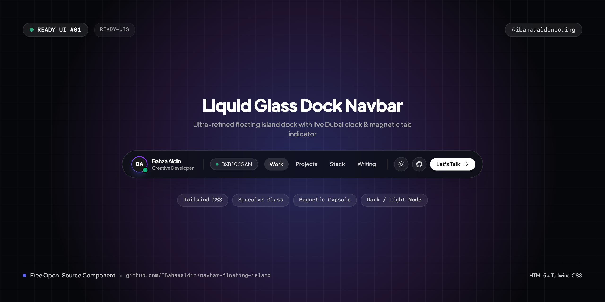
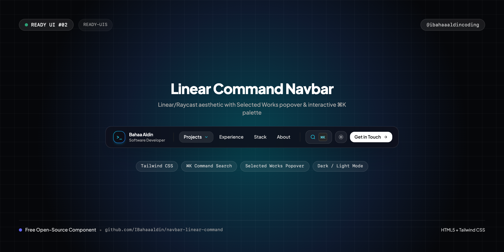
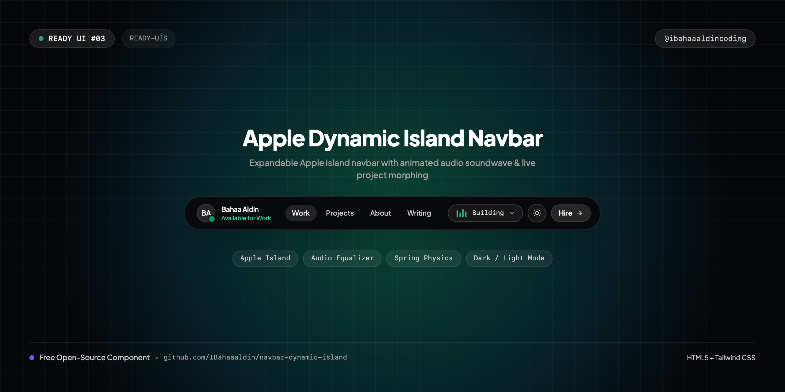
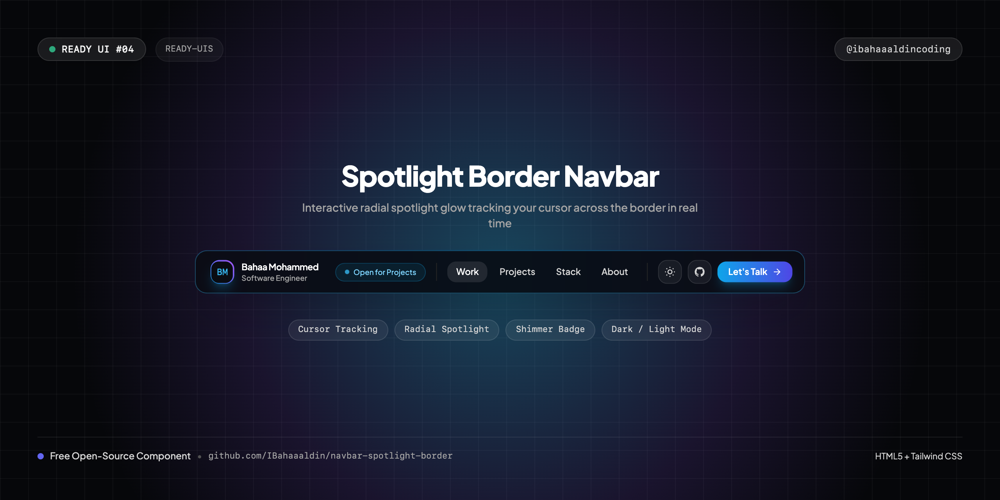
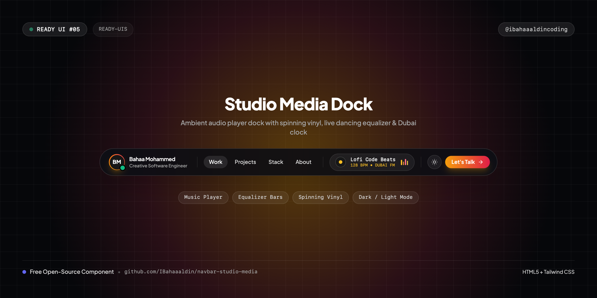
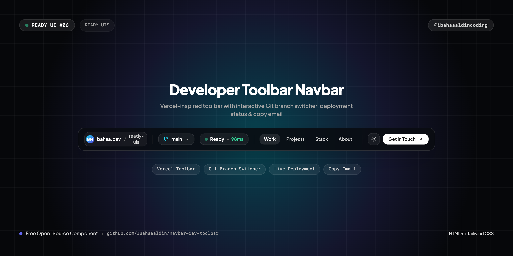
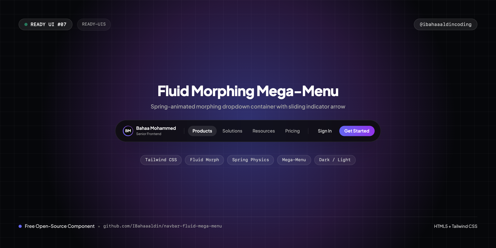
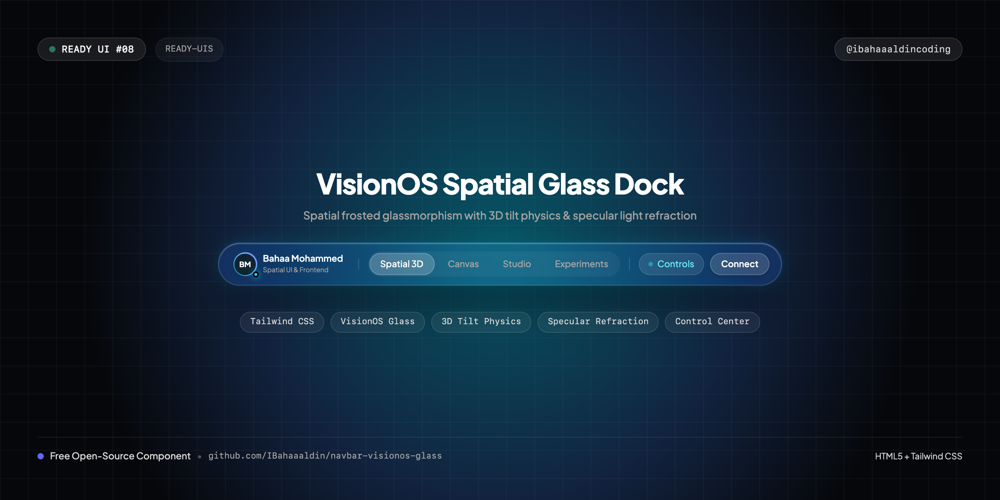

# 🚀 Ready-UIs

A curated collection of production-ready, highly aesthetic frontend UI components and patterns. Built with zero friction, modern design standards (Linear, Apple, Vercel vibes), and ready to drop straight into your web projects.

Created & maintained by **Bahaa Mohammed** ([@ibahaaaldincoding](https://www.instagram.com/ibahaaaldincoding)).

---

## 📂 Repository Structure

Components are grouped into category folders (e.g. `navbars/`, `cards/`, `modals/`). Each component contains:
1. **Implementation files** (`index.html`) — clean, self-contained, and copy-pasteable.
2. **Cover Images** (`cover.png`, `cover-instagram.png`, `cover-reel.png`) — high-resolution banners (1280x640 widescreen, 1080x1080 Instagram square post, and 1080x1920 Instagram 9:16 vertical Reel).
3. **Screenshots (Desktop & Mobile)** (`screenshot-desktop.png`, `screenshot-mobile.png`) — high-resolution visual previews.
4. **Videos (Desktop & Mobile)** (`video-desktop.mp4`, `video-mobile.mp4`) — automated video recordings showcasing animations, micro-interactions, responsive menus, and theme switching.
5. **`README.md`** — setup notes, customization guide, and features.
6. **`CAPTION.md`** — ready-to-copy social media caption tailored for Instagram (`@ibahaaaldincoding`).

```text
Ready-UIs/
├── navbars/
│   ├── 01-floating-island-navbar/
│   │   ├── index.html
│   │   ├── cover.png
│   │   ├── cover-instagram.png
│   │   ├── cover-reel.png
│   │   ├── screenshot-desktop.png
│   │   ├── video-desktop.mp4
│   │   ├── screenshot-mobile.png
│   │   ├── video-mobile.mp4
│   │   ├── record.js
│   │   ├── README.md
│   │   └── CAPTION.md
│   ├── 02-linear-command-navbar/
│   │   ├── index.html
│   │   ├── cover.png
│   │   ├── cover-instagram.png
│   │   ├── cover-reel.png
│   │   ├── screenshot-desktop.png
│   │   ├── video-desktop.mp4
│   │   ├── screenshot-mobile.png
│   │   ├── video-mobile.mp4
│   │   ├── record.js
│   │   ├── README.md
│   │   └── CAPTION.md
│   ├── 03-dynamic-island-navbar/
│   │   ├── index.html
│   │   ├── cover.png
│   │   ├── cover-instagram.png
│   │   ├── cover-reel.png
│   │   ├── screenshot-desktop.png
│   │   ├── video-desktop.mp4
│   │   ├── screenshot-mobile.png
│   │   ├── video-mobile.mp4
│   │   ├── record.js
│   │   ├── README.md
│   │   └── CAPTION.md
│   ├── 04-spotlight-border-navbar/
│   │   ├── index.html
│   │   ├── cover.png
│   │   ├── cover-instagram.png
│   │   ├── cover-reel.png
│   │   ├── screenshot-desktop.png
│   │   ├── video-desktop.mp4
│   │   ├── screenshot-mobile.png
│   │   ├── video-mobile.mp4
│   │   ├── record.js
│   │   ├── README.md
│   │   └── CAPTION.md
│   ├── 05-studio-media-navbar/
│   │   ├── index.html
│   │   ├── cover.png
│   │   ├── cover-instagram.png
│   │   ├── cover-reel.png
│   │   ├── screenshot-desktop.png
│   │   ├── video-desktop.mp4
│   │   ├── screenshot-mobile.png
│   │   ├── video-mobile.mp4
│   │   ├── record.js
│   │   ├── README.md
│   │   └── CAPTION.md
│   ├── 06-dev-toolbar-navbar/
│   │   ├── index.html
│   │   ├── cover.png
│   │   ├── cover-instagram.png
│   │   ├── cover-reel.png
│   │   ├── screenshot-desktop.png
│   │   ├── video-desktop.mp4
│   │   ├── screenshot-mobile.png
│   │   ├── video-mobile.mp4
│   │   ├── record.js
│   │   ├── README.md
│   │   └── CAPTION.md
│   ├── 07-fluid-mega-menu-navbar/
│   │   ├── index.html
│   │   ├── cover.png
│   │   ├── cover-instagram.png
│   │   ├── cover-reel.png
│   │   ├── screenshot-desktop.png
│   │   ├── video-desktop.mp4
│   │   ├── screenshot-mobile.png
│   │   ├── video-mobile.mp4
│   │   ├── record.js
│   │   ├── README.md
│   │   └── CAPTION.md
│   └── 08-visionos-glass-navbar/
│       ├── index.html
│       ├── cover.png
│       ├── cover-instagram.png
│       ├── cover-reel.png
│       ├── screenshot-desktop.png
│       ├── video-desktop.mp4
│       ├── screenshot-mobile.png
│       ├── video-mobile.mp4
│       ├── record.js
│       ├── README.md
│       └── CAPTION.md
└── ...
```

---

## 💎 Available Components

### 🧭 Navbars

| # | Component Name | Cover Preview | Standalone Repository | Live Demo | Highlights |
| :-: | :--- | :--- | :--- | :--- | :--- |
| **01** | [**Floating Island Navbar**](navbars/01-floating-island-navbar/) | [](navbars/01-floating-island-navbar/) | [GitHub Repo](https://github.com/IBahaaaldin/navbar-floating-island) | [Live Demo](https://IBahaaaldin.github.io/navbar-floating-island/) | `Apple macOS Dock`, `Sliding Capsule`, `Dubai Clock`, `Dark/Light Switch` |
| **02** | [**Linear Command Navbar**](navbars/02-linear-command-navbar/) | [](navbars/02-linear-command-navbar/) | [GitHub Repo](https://github.com/IBahaaaldin/navbar-linear-command) | [Live Demo](https://IBahaaaldin.github.io/navbar-linear-command/) | `Linear Command Bar`, `Projects Dropdown`, `⌘K Search`, `Dark/Light Switch` |
| **03** | [**Dynamic Island Navbar**](navbars/03-dynamic-island-navbar/) | [](navbars/03-dynamic-island-navbar/) | [GitHub Repo](https://github.com/IBahaaaldin/navbar-dynamic-island) | [Live Demo](https://IBahaaaldin.github.io/navbar-dynamic-island/) | `Apple Dynamic Island`, `Soundwave Activity`, `Fluid Expansion`, `Dark/Light Switch` |
| **04** | [**Spotlight Border Navbar**](navbars/04-spotlight-border-navbar/) | [](navbars/04-spotlight-border-navbar/) | [GitHub Repo](https://github.com/IBahaaaldin/navbar-spotlight-border) | [Live Demo](https://IBahaaaldin.github.io/navbar-spotlight-border/) | `Cursor Spotlight Glow`, `Shimmer Badge`, `Iridescent Border`, `Dark/Light Switch` |
| **05** | [**Studio Media Navbar**](navbars/05-studio-media-navbar/) | [](navbars/05-studio-media-navbar/) | [GitHub Repo](https://github.com/IBahaaaldin/navbar-studio-media) | [Live Demo](https://IBahaaaldin.github.io/navbar-studio-media/) | `Audio Player`, `Dancing Equalizer`, `Spinning Vinyl`, `Dark/Light Switch` |
| **06** | [**Developer Toolbar Navbar**](navbars/06-dev-toolbar-navbar/) | [](navbars/06-dev-toolbar-navbar/) | [GitHub Repo](https://github.com/IBahaaaldin/navbar-dev-toolbar) | [Live Demo](https://IBahaaaldin.github.io/navbar-dev-toolbar/) | `Vercel Toolbar`, `Git Branch Switcher`, `Live 98ms Metric`, `Copy Email` |
| **07** | [**Fluid Morphing Mega-Menu**](navbars/07-fluid-mega-menu-navbar/) | [](navbars/07-fluid-mega-menu-navbar/) | [GitHub Repo](https://github.com/IBahaaaldin/navbar-fluid-mega-menu) | [Live Demo](https://IBahaaaldin.github.io/navbar-fluid-mega-menu/) | `Stripe Mega-Menu`, `Morphing Container`, `Sliding Arrow`, `Spring Physics` |
| **08** | [**VisionOS Spatial Glass Dock**](navbars/08-visionos-glass-navbar/) | [](navbars/08-visionos-glass-navbar/) | [GitHub Repo](https://github.com/IBahaaaldin/navbar-visionos-glass) | [Live Demo](https://IBahaaaldin.github.io/navbar-visionos-glass/) | `VisionOS Glass`, `3D Perspective Tilt`, `Specular Refraction`, `Control Center` |

---

## 🛠 Tech Stack & Design Principles

- **Framework Agnostic**: Standard modern HTML5 + Tailwind CSS CDN + inline SVGs.
- **Ultra Polish**: Micro-interactions, tactile press feedback, dark/light mode ergonomics, and responsive layout.
- **Zero Config**: Opens directly in any browser without needing `npm install` or bundlers.
- **Automation Ready**: Comes with automated recording scripts (`record.js`) using Playwright to generate Instagram videos and GIFs.

---

## 📬 Connect

- **Instagram**: [@ibahaaaldincoding](https://www.instagram.com/ibahaaaldincoding)
- **GitHub**: [@IBahaaaldin](https://github.com/IBahaaaldin)
- **LinkedIn**: [Bahaa Mohammed](https://www.linkedin.com/in/bahaa-mohammed-371259369)
- **Email**: bahaam.coding@gmail.com
