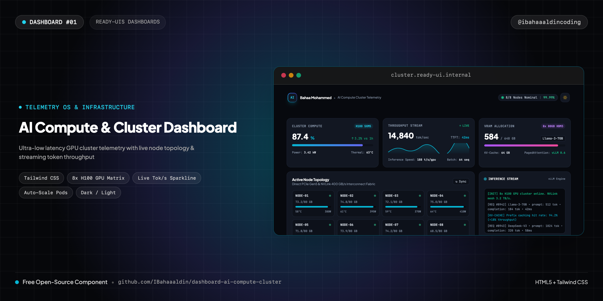
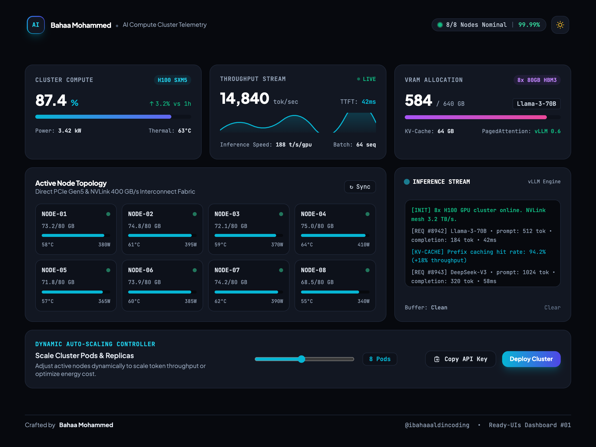
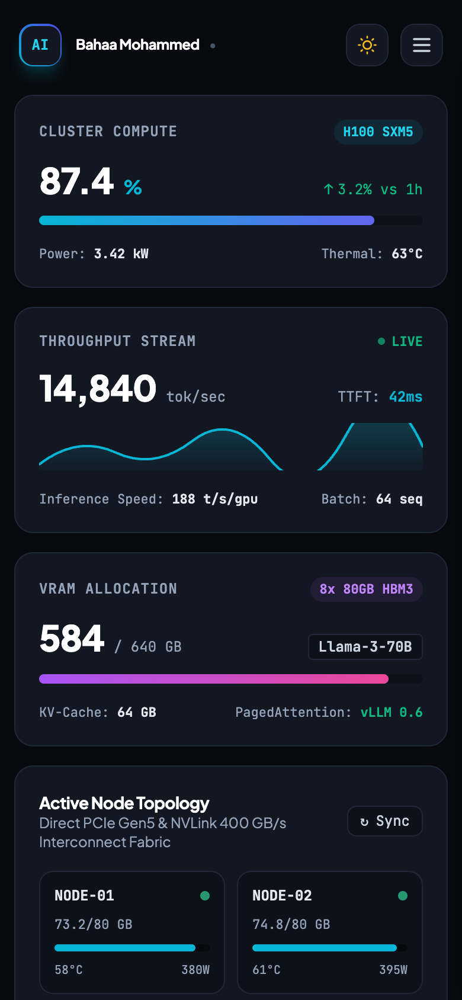
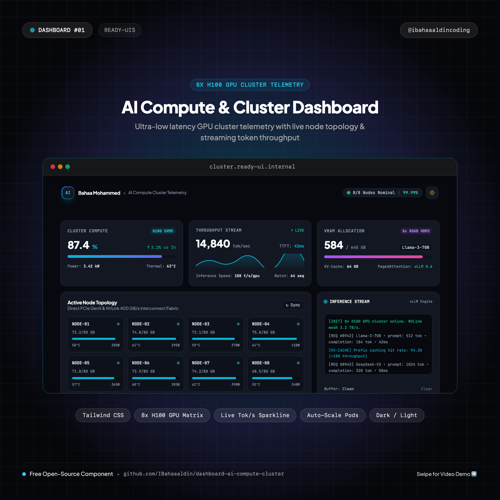
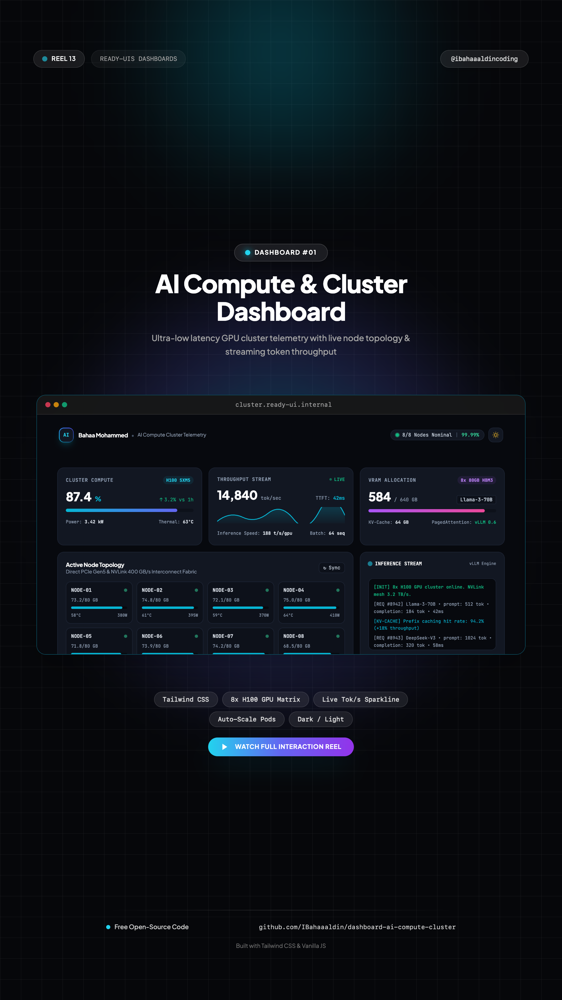

# ⚡ AI Compute & Cloud Infrastructure Dashboard

> Real-time AI cluster telemetry dashboard featuring 8-node GPU topology matrix, live token throughput sparkline, dynamic pod auto-scaler, and Web Audio feedback.



[](https://IBahaaaldin.github.io/dashboard-ai-compute-cluster/)
[](https://IBahaaaldin.github.io/dashboard-ai-compute-cluster/)

---

## 🌐 Visual Previews

| Desktop Showcase (1200x900) | Mobile Showcase (390x844) | Post Cover (1080x1080) | Reel Cover (1080x1920) |
| :---: | :---: | :---: | :---: |
|  |  |  |  |

*(Includes full interaction videos: `video-desktop.mp4` and `video-mobile.mp4`)*

---

## ✨ Features & Micro-Interactions

- **8-Node GPU Cluster Topology Matrix**: Live visualization of 8x NVIDIA H100 SXM5 compute nodes with individual VRAM consumption (73.2/80 GB), thermal sensors (55°C–64°C), power draw (340W–410W), and pulsating health beacons.
- **Real-Time Token Throughput Stream**: Fluctuating token-per-second generator (`~14,840 tok/s`) with live reactive SVG sparkline charting and sub-50ms Time-To-First-Token (TTFT) metrics.
- **Dynamic Auto-Scaling Controller**: Interactive replica slider (1–16 pods) dynamically recalculating cluster load, active nodes, and theoretical throughput in real time.
- **Terminal Inference Stream**: Live auto-scrolling log console outputting realistic vLLM / PagedAttention request batches, prefix caching hit rates (94.2%), and router dispatch logs.
- **Obsidian Dark / Crisp Light Mode**: High-contrast theme switcher with custom color palette (Deep Obsidian Void `#07090e`, Card `#121722`, and Crisp Frosted Daylight).
- **Embedded Web Audio Synthesizer**: Clean 880Hz / 1760Hz UI micro-beeps on cluster sync, slider changes, and copy interactions (zero external audio files).
- **Slide-in Mobile Sheet Drawer**: Slide-out mobile drawer on screens `<768px` featuring cluster health summaries, node counters, and quick actions.
- **Copy API Key & Deploy Cluster Actions**: Interactive one-click key copy with checkmark feedback state and vibrant gradient deployment button.
- **Zero Build Step**: Pure standalone HTML5, Tailwind CSS CDN, and vanilla ES6 JavaScript.

---

## 📁 Repository Structure

```text
├── index.html              # Standalone production dashboard component
├── cover.png               # Widescreen cover banner (2560x1280)
├── cover-instagram.png     # Square post cover for Instagram (@ibahaaaldincoding) (2160x2160)
├── cover-reel.png          # 9:16 vertical cover for Instagram Reels (2160x3840)
├── screenshot-desktop.png  # Desktop visual preview (2400x1800)
├── video-desktop.mp4       # Desktop interaction recording (1200x900 @ 30fps)
├── screenshot-mobile.png   # Mobile visual preview (780x1688)
├── video-mobile.mp4        # Mobile interaction recording (390x844 @ 30fps)
├── record.js               # Playwright automation script used to record all 4 assets
├── README.md               # Standardized documentation & setup notes
└── CAPTION.md              # Ready-to-copy Instagram caption for @ibahaaaldincoding
```

---

## 🚀 Quick Start

### 1. View Locally
Simply open `index.html` in your browser:
```bash
open index.html
```

### 2. Re-record Assets
To re-record desktop & mobile screenshots and videos:
```bash
node record.js
```

---

## 👤 Author & Connect

**Bahaa Mohammed**  
Creative Developer & Software Engineer
- 📸 **Instagram**: [@ibahaaaldincoding](https://www.instagram.com/ibahaaaldincoding)
- 🐙 **GitHub**: [@IBahaaaldin](https://github.com/IBahaaaldin)
- 💼 **LinkedIn**: [Bahaa Mohammed](https://www.linkedin.com/in/bahaa-mohammed-371259369)
- 📧 **Email**: bahaam.coding@gmail.com

---

## 📄 License

MIT © [Bahaa Mohammed](https://github.com/IBahaaaldin)
