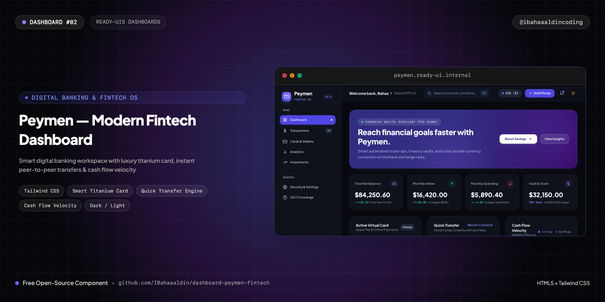
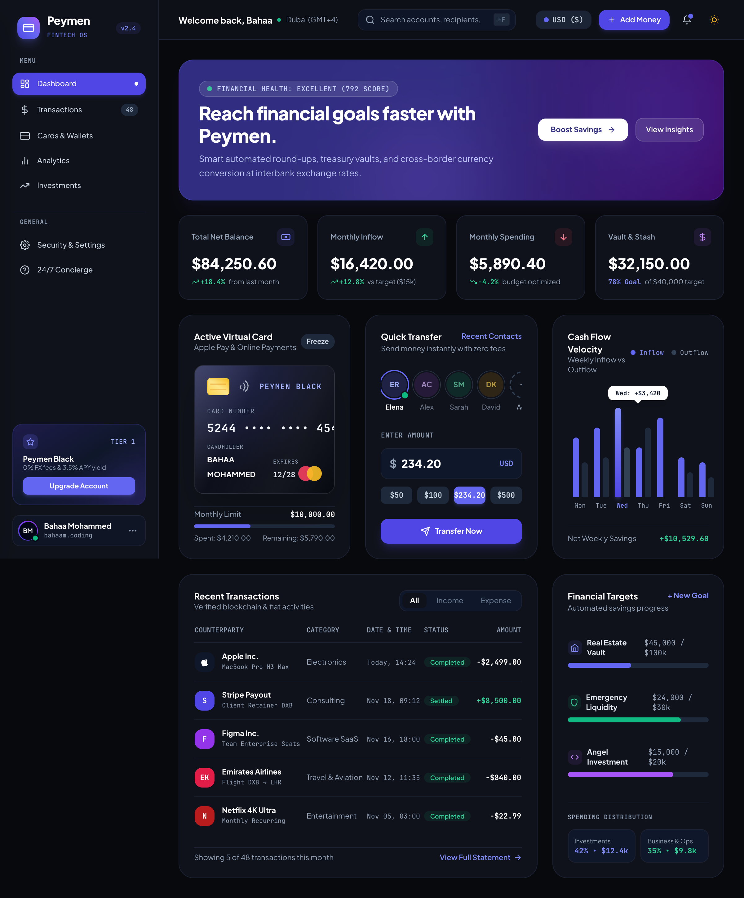
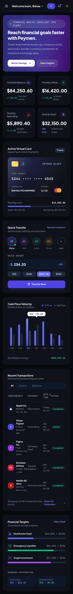
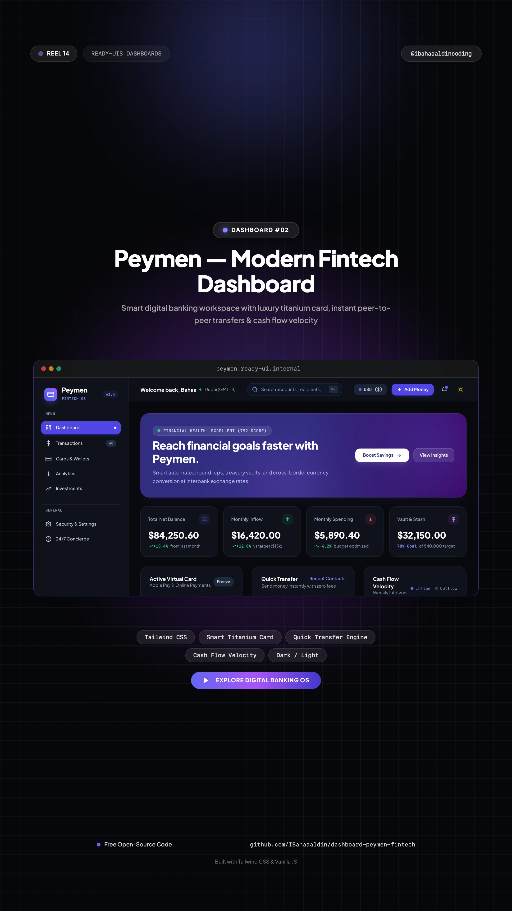

# 💳 Peymen — Modern Fintech & Digital Banking Dashboard

> High-craft digital banking workspace engineered with pure HTML5, Tailwind CSS, and Vanilla JavaScript featuring luxury virtual titanium card, peer-to-peer quick transfer, cash flow analytics, and live activity tracking.



[](https://IBahaaaldin.github.io/dashboard-peymen-fintech/)
[](https://IBahaaaldin.github.io/dashboard-peymen-fintech/)

---

## 🌐 Visual Previews

| Desktop Showcase (1200x900) | Mobile Showcase (390x844) | Post Cover (1080x1080) | Reel Cover (1080x1920) |
| :---: | :---: | :---: | :---: |
|  |  |  |  |

---

## ✨ Features & Micro-Interactions

- **Full-Page Edge-to-Edge Architecture**: Designed as a production-grade full-screen SaaS banking interface with docked left navigation sidebar, sticky command header (`⌘F`), and responsive multi-column layout.
- **Realistic Virtual Titanium Card**: Obsidian gradient debit card with EMV gold chip simulation, contactless payment icon, Mastercard dual circles, masked numbers, cardholder typography, and interactive 1-click **Freeze / Unfreeze** toggle.
- **Hero Financial Health Accelerator**: Gradient banner displaying real-time credit health score (`792 Excellent`) with smart automated stash shortcuts.
- **4 Key Financial Metric Cards**: "Total Net Balance" (`$84,250.60` with `+18.4%` monthly delta), "Monthly Inflow" (`$16,420.00`), "Monthly Spending" (`$5,890.40` budget optimized), and "Vault & Stash" (`$32,150.00` with 78% milestone progress).
- **Interactive Quick Transfer Engine**: Peer-to-peer transfer module featuring recent contact avatars (Elena, Alex, Sarah, David), customizable preset chips (`$50`, `$100`, `$234.20`, `$500`), live currency inputs, and instant transfer sound feedback with toast confirmation.
- **Cash Flow Velocity Bar Chart**: Weekly dual-stripe comparison bars (Mon–Sun) tracking Inflow vs Outflow with dynamic hovering tooltip (`Wed: +$3,420`).
- **Verified Transactions Data Table**: Multi-tab filtering (`All`, `Income`, `Expense`), verified counterparties (Apple, Stripe Payouts, Figma, Emirates Airlines, Netflix), category badges, and amount indicators.
- **Automated Financial Targets**: Real Estate Vault (`$45k / $100k`), Emergency Liquidity (`$24k / $30k`), and Angel Investment progress bars with percentage spending distribution.
- **Built-in Web Audio API Synthesizer**: Tactile audio clicks on UI buttons and musical arpeggio chords on successful money transfers (zero external audio files).
- **Daylight Clean ↔ Deep Obsidian Dark Mode**: Seamless toggle between crisp white minimalism and dark obsidian fintech styling.
- **Zero Build Step**: Pure standalone HTML5, Tailwind CSS CDN, and vanilla ES6 JavaScript.

---

## 📁 Repository Structure

```text
├── index.html              # Standalone production dashboard component
├── cover.png               # Widescreen cover banner (2560x1280)
├── cover-instagram.png     # Square post cover for Instagram (@ibahaaaldincoding) (2160x2160)
├── cover-reel.png          # 9:16 vertical cover for Instagram Reels (2160x3840)
├── screenshot-desktop.png  # Desktop visual preview (2400x2894)
├── screenshot-mobile.png   # Mobile visual preview (780x6298)
├── record.js               # Playwright automation script used to capture screenshots
├── README.md               # Standardized documentation & setup notes
└── CAPTION.md              # Ready-to-copy Instagram caption for @ibahaaaldincoding
```

---

## 🚀 Quick Start

### 1. View Locally

Simply open `index.html` in your browser:

```bash
open index.html
```

### 2. Re-record Assets

To re-record desktop & mobile screenshots:

```bash
node record.js
```

---

## 👤 Author & Connect

**Bahaa Mohammed**  
*Creative Developer & Software Engineer*

- 📸 **Instagram**: [@ibahaaaldincoding](https://www.instagram.com/ibahaaaldincoding)
- 🐙 **GitHub**: [@IBahaaaldin](https://github.com/IBahaaaldin)
- 💼 **LinkedIn**: [Bahaa Mohammed](https://www.linkedin.com/in/bahaa-mohammed-371259369)
- 📧 **Email**: [bahaam.coding@gmail.com](mailto:bahaam.coding@gmail.com)

---

## 📄 License

MIT © [Bahaa Mohammed](https://github.com/IBahaaaldin)
