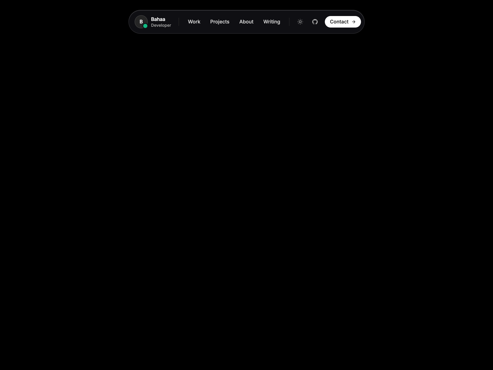

# 🏝️ 01 — Floating Island Navbar

A standalone, floating glassmorphism navbar on a clean canvas with built-in **Dark/Light Theme Switcher** and **Magnetic Sliding Pill Hover Animation**.



*(Includes 4 responsive assets: `screenshot-desktop.png`, `video-desktop.mp4`, `screenshot-mobile.png`, and `video-mobile.mp4`)*

---

## ✨ Features & Tricks

- **Clean Minimal Canvas**: Pure black (`#000000`) or pure crisp white (`#ffffff`) empty canvas with zero clutter.
- **Fluid Theme Switcher**: Sun ☀️ / Moon 🌙 button built directly into the navbar that dynamically toggles dark/light mode across the entire page.
- **Magnetic Sliding Pill**: A smooth, physics-based hover pill that slides and morphs behind whichever nav item the cursor hovers over.
- **Brand & Live Status**: Monogram avatar with an animated green pulse indicator (`Available for projects` 🟢).
- **Responsive Mobile Drawer**: Seamless transitions between full desktop floating dock and mobile hamburger with slide-down menu.
- **Socials & Instant CTA**: Direct GitHub, LinkedIn, and Instagram profile icons with a high-contrast gradient "Let's Talk" button.
- **Zero-Dependency**: 100% self-contained HTML5 + Tailwind CSS + inline SVGs. Copy and paste straight into any project.

---

## 📁 File Structure

```text
01-floating-island-navbar/
├── index.html              # Clean component & empty canvas page
├── screenshot-desktop.png  # Desktop visual preview (1440x900)
├── video-desktop.mp4       # Desktop interaction recording
├── screenshot-mobile.png   # Mobile visual preview (390x844)
├── video-mobile.mp4        # Mobile interaction recording
├── record.js               # Playwright automation script used to record all 4 assets
├── README.md               # Documentation & setup notes
└── CAPTION.md              # Ready-to-copy Instagram caption for @ibahaaaldincoding
```

---

## 🚀 How to Run

### 1. View in Browser
Simply open `index.html` in your browser:
```bash
open index.html
```

### 2. Record New Video / GIF
If you want to re-record the interaction video after making customizations:
```bash
node record.js
```
This will automatically generate new `screenshot.png`, `preview.mp4`, and `preview.gif` files!

---

## 🎨 Customization

| Feature | Where to edit in `index.html` |
| :--- | :--- |
| **Monogram** | Change `IB` to your own initials |
| **Links** | Edit `<div id="navPills">` links |
| **Socials** | Update GitHub, LinkedIn, and Instagram `href` attributes |
| **Colors** | Tailwind classes: `bg-indigo-500`, `dark:bg-[#08090d]`, etc. |
