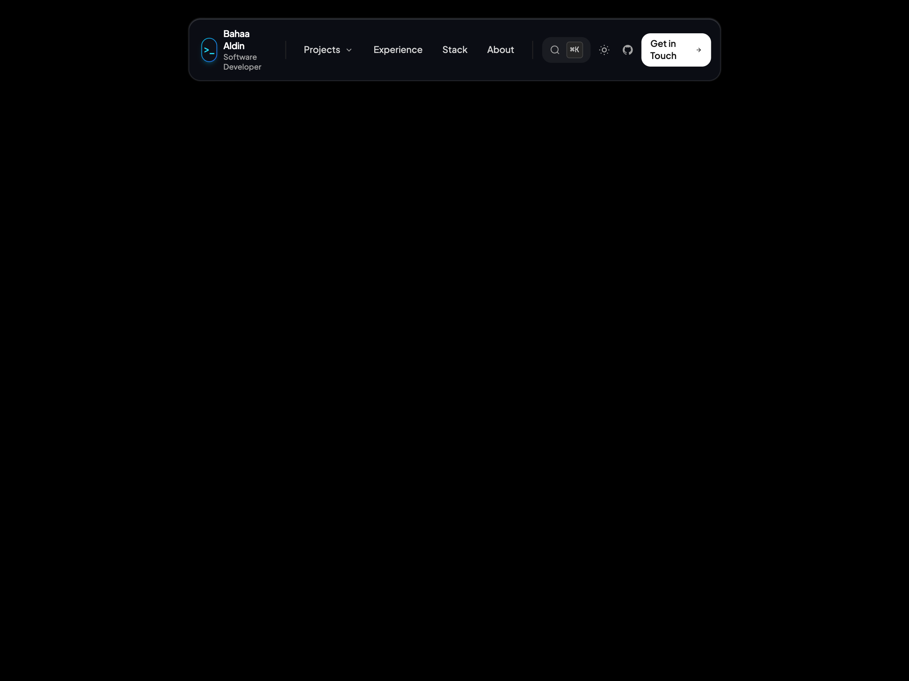

# ⚡ 02 — Linear Command Navbar

A centered, Linear/Raycast-inspired command bar on a clean empty canvas with built-in **Dark/Light Theme Switcher**, **Hoverable Projects Dropdown Popover**, and a full **`⌘K` / `Ctrl+K` Command Palette Search Pop-up**.



*(Includes 4 responsive assets: `screenshot-desktop.png`, `video-desktop.mp4`, `screenshot-mobile.png`, and `video-mobile.mp4`)*

---

## ✨ Features & Tricks

- **Dead-Center Layout**: Floats cleanly in the exact middle of the page on an immaculate pure black (`#000000`) or white (`#ffffff`) canvas.
- **Fixed Dropdown Navigation**: Features an invisible hover bridge and click-toggle so you can smoothly glide down into the popover and click project links (*Air Canvas*, *Neon Aura AR*, *GPA & Finance Apps*).
- **Interactive `⌘K` Command Search Pop-up**:
  - Opens on clicking the `⌘K` button or pressing `⌘K` / `Ctrl+K` on the keyboard.
  - Full backdrop blur overlay.
  - Live search input that filters commands and projects in real-time.
  - Quick actions to toggle theme, copy email, open GitHub, or navigate to projects.
  - Press `ESC` or click outside to dismiss.
- **Responsive Mobile Drawer**: Mobile navigation with integrated search trigger and slide-down drawer.
- **One-Click Theme Switcher**: ☀️/🌙 button seamlessly flipping the entire page between dark and light themes.
- **Zero-Dependency**: 100% self-contained HTML5 + Tailwind CSS + inline SVGs.

---

## 📁 File Structure

```text
navbars/02-linear-command-navbar/
├── index.html              # Clean component & empty canvas page
├── screenshot-desktop.png  # Desktop visual preview (1440x900)
├── video-desktop.mp4       # Desktop interaction recording
├── screenshot-mobile.png   # Mobile visual preview (390x844)
├── video-mobile.mp4        # Mobile interaction recording
├── record.js               # Playwright automation script used to record all 4 assets
├── README.md               # Documentation & integration notes
└── CAPTION.md              # Ready-to-copy Instagram caption for @ibahaaaldincoding
```

---

## 🚀 How to Run

### 1. View in Browser
Open `index.html` directly in your browser:
```bash
open index.html
```

### 2. Re-Record Video / GIF
To re-record interactions after editing:
```bash
node record.js
```
