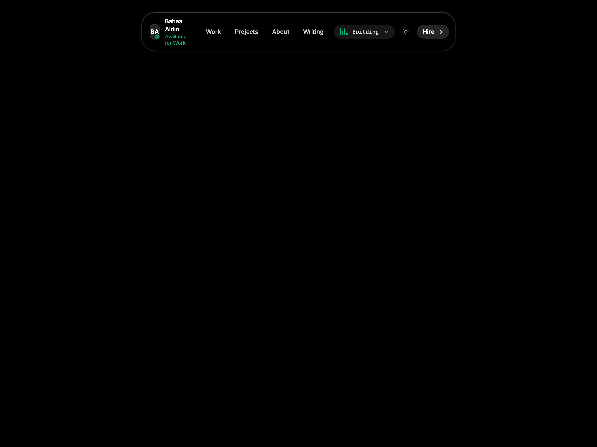

# 🏝️ 03 — Apple Dynamic Island Navbar

An interactive, fluid Dynamic Island navbar inspired by iOS and Apple hardware design. Sits cleanly at the top of the viewport on a pure black or white canvas, featuring live activity indicators, soundbar visualizer, fluid morphing expansion, and one-click theme switcher.



*(Includes 4 responsive assets: `screenshot-desktop.png`, `video-desktop.mp4`, `screenshot-mobile.png`, and `video-mobile.mp4`)*

---

## ✨ Features & Tricks

- **Apple Dynamic Island Physics**: Starts as a compact resting pill and springs open smoothly with Apple-style cubic-bezier timing (`cubic-bezier(0.175, 0.885, 0.32, 1.15)`).
- **Live Activity Waveform**: Animated equalizer bars displaying live development status (`Building: Air Canvas ⚡`).
- **Interactive Expansion**: Expanding reveals live project repo card, mobile navigation rows, social links, and direct contact CTA.
- **Top-Anchored Website Responsiveness**: Anchored gracefully at `top-3` on mobile and `top-6` on desktop. Never jumps into the vertical center of the screen when resizing.
- **Fluid Dark / Light Theme Switcher**: Sun ☀️ / Moon 🌙 button built directly into the island that flips the canvas between pure black (`#000000`) and pure white (`#ffffff`).
- **Zero-Dependency**: 100% self-contained HTML5 + Tailwind CSS + inline SVGs.

---

## 📁 File Structure

```text
navbars/03-dynamic-island-navbar/
├── index.html              # Clean component & canvas page
├── screenshot-desktop.png  # Desktop visual preview (1440x900)
├── video-desktop.mp4       # Desktop interaction recording
├── screenshot-mobile.png   # Mobile visual preview (390x844)
├── video-mobile.mp4        # Mobile interaction recording
├── record.js               # Playwright automation recording script
├── README.md               # Documentation & setup notes
└── CAPTION.md              # Ready-to-copy Instagram caption for @ibahaaaldincoding
```

---

## 🚀 How to Run

### 1. View in Browser
Open `index.html` directly in any web browser:
```bash
open index.html
```

### 2. Re-Record Video Previews
```bash
node record.js
```
