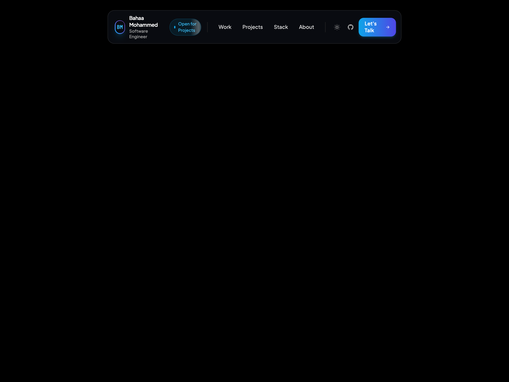

# 🔦 04 — Spotlight Border Navbar

An ultra-sleek, Raycast and Stripe-inspired floating navbar on a clean canvas with an **Interactive Cursor Spotlight Glow**, **Animated Shimmer Status Badge**, and built-in **Dark/Light Theme Switcher**.



*(Includes 4 responsive assets: `screenshot-desktop.png`, `video-desktop.mp4`, `screenshot-mobile.png`, and `video-mobile.mp4`)*

---

## ✨ Features & Tricks

- **Interactive Cursor Spotlight**: A dynamic radial gradient spotlight tracks your mouse position in real-time, casting a luminous chromatic cyan/purple glow across the outer border and glass surface.
- **Animated Shimmer Badge**: High-contrast "Open for Projects ✨" badge with a continuous light reflection beam.
- **Top-Anchored Website Responsiveness**: Anchored gracefully at `top-3` on mobile and `top-6` on desktop. Never jumps into the vertical center of the screen when resizing.
- **Mobile Spotlight Drawer**: Expanding reveals clean numbered project rows (`01 Selected Work`, `02 Projects`, `03 Stack`, `04 About`), social links, and gradient CTA.
- **One-Click Theme Switcher**: Sun ☀️ / Moon 🌙 button seamlessly flipping the entire page between pure black (`#000000`) and pure white (`#ffffff`).
- **Zero-Dependency**: 100% self-contained HTML5 + Tailwind CSS + inline SVGs.

---

## 📁 File Structure

```text
navbars/04-spotlight-border-navbar/
├── index.html              # Clean component & canvas page
├── screenshot-desktop.png  # Desktop visual preview (1440x900)
├── video-desktop.mp4       # Desktop interaction recording
├── screenshot-mobile.png   # Mobile visual preview (390x844)
├── video-mobile.mp4        # Mobile interaction recording
├── record.js               # Playwright automation recording script
├── README.md               # Documentation & setup notes
└── CAPTION.md              # Ready-to-copy Instagram caption for @ibahaaaldincoding
```

---

## 🚀 How to Run

### 1. View in Browser
Open `index.html` directly in any web browser:
```bash
open index.html
```

### 2. Re-Record Video Previews
```bash
node record.js
```
