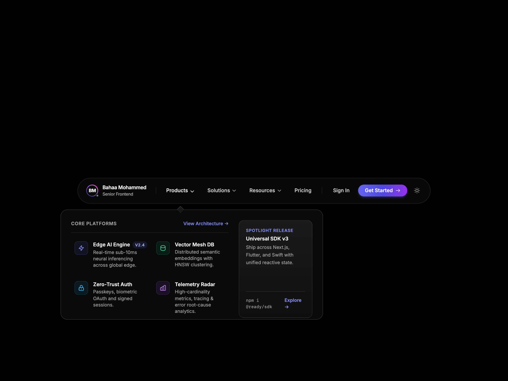

# 🌊 Fluid Morphing Mega-Menu Navbar

A high-craft, production-ready frontend navigation bar featuring fluid morphing container mechanics inspired by Stripe, Supabase, and Raycast.

Crafted by **Bahaa Mohammed** ([@ibahaaaldincoding](https://www.instagram.com/ibahaaaldincoding)).

---

## ✨ Features & Motion Mechanics

- **Fluid Morphing Container**: As you hover between navigation tabs (*Products*, *Solutions*, *Resources*), the dropdown container dynamically animates its width, height, and horizontal offset with spring physics (`cubic-bezier(0.16, 1, 0.3, 1)`).
- **Gliding Indicator Arrow**: A top pointer arrow tracks the active tab trigger seamlessly across transitions.
- **Cross-Fade & Slide**: Internal tab sections cross-fade with directional spatial slide.
- **Instant Dark / Light Mode**: Seamlessly toggles between `#000000` pitch black and `#ffffff` pure white backdrops with matching frosted glass styling.
- **Strict Single-Row Typography**: All badges, titles, and creator tags utilize `whitespace-nowrap` to prevent awkward line breaks.
- **Centered Canvas**: Placed dead-center horizontally and vertically for clean presentation and embeddability.
- **Mobile Responsive Drawer**: Mobile header with brand badge, theme switch, and expandable accordion drawer with micro-interactions.
- **Zero Build Step**: Drop-in ready HTML5, Tailwind CSS CDN, and vanilla JS.

---

## 📸 Media Preview

| Desktop Preview | Mobile View |
| :---: | :---: |
|  |  |

---

## 🚀 Quick Start

Simply clone and open `index.html` in any modern web browser:

```bash
git clone https://github.com/IBahaaaldin/navbar-fluid-mega-menu.git
cd navbar-fluid-mega-menu
open index.html
```

---

## 🛠 Tech Stack

- **HTML5 & CSS3**
- **Tailwind CSS (v3 CDN)**
- **Vanilla JavaScript (Spring physics & DOM calculations)**
- **Playwright & FFmpeg** (Automated video and asset generation)

---

## 👤 Author

**Bahaa Mohammed**
- Instagram: [@ibahaaaldincoding](https://www.instagram.com/ibahaaaldincoding)
- GitHub: [@IBahaaaldin](https://github.com/IBahaaaldin)
- Portfolio: [Ready-UIs](https://github.com/IBahaaaldin/Ready-UIs)
