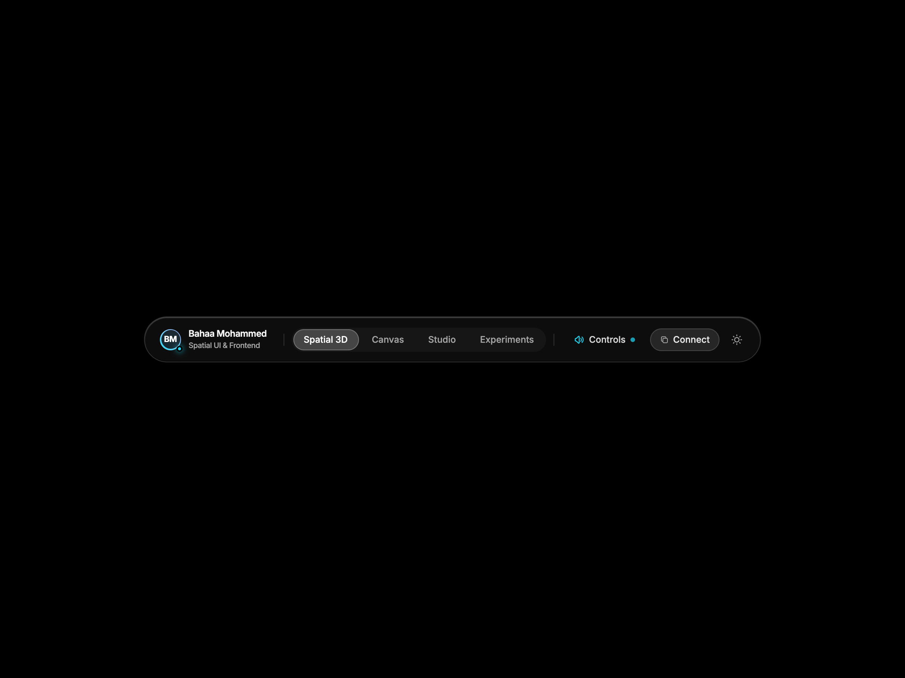

# 🪟 VisionOS Spatial Glass Dock Navbar

An ultra-premium, production-ready frontend navigation dock featuring spatial glassmorphism, 3D perspective tilt physics, and dynamic specular light refraction inspired by Apple Vision Pro / visionOS.

Crafted by **Bahaa Mohammed** ([@ibahaaaldincoding](https://www.instagram.com/ibahaaaldincoding)).

---

## ✨ Features & Motion Mechanics

- **Interactive 3D Perspective Tilt**: Moving your cursor over the dock tilts the navbar smoothly in 3D coordinate space (`rotateX`, `rotateY`, `scale3d`).
- **Dynamic Specular Light Refraction**: Border and surface glass highlight tracks cursor coordinates `(x, y)` in real-time, simulating realistic optical lens reflection.
- **Magnetic Glass Active Pill**: Seamless sliding glass capsule between tabs (*Spatial 3D*, *Canvas*, *Studio*, *Experiments*) with spring physics.
- **VisionOS Control Center Popover**: Interactive floating glass modal with Spatial Audio toggle switch and real-time environment immersion range slider.
- **Tactile Quick Action**: One-click "Connect" button that copies email (`bahaam.coding@gmail.com`) with instant checkmark transition and `Copied! ✨` tooltip feedback.
- **Instant Dark / Light Mode**: Toggles seamlessly between deep space pitch black (`#000000`) and ambient daylight frosted glass (`#ffffff`).
- **Strict Single-Row Typography**: Creator name, roles, and status tags are locked into single lines (`whitespace-nowrap`).
- **Centered Canvas**: Dead-center placement across all viewports.
- **Mobile Responsive Drawer**: Mobile glass header with hamburger toggle and spatial drawer.
- **Zero Build Step**: Drop-in HTML5, Tailwind CSS CDN, and vanilla JS.

---

## 📸 Media Preview

| Desktop Preview | Mobile View |
| :---: | :---: |
|  |  |

---

## 🚀 Quick Start

```bash
git clone https://github.com/IBahaaaldin/navbar-visionos-glass.git
cd navbar-visionos-glass
open index.html
```

---

## 🛠 Tech Stack

- **HTML5 & Modern CSS3**
- **Tailwind CSS (v3 CDN)**
- **Vanilla JavaScript (3D tilt calculations & specular coordinates)**
- **Playwright & FFmpeg** (Automated video and asset generation)

---

## 👤 Author

**Bahaa Mohammed**
- Instagram: [@ibahaaaldincoding](https://www.instagram.com/ibahaaaldincoding)
- GitHub: [@IBahaaaldin](https://github.com/IBahaaaldin)
- Portfolio: [Ready-UIs](https://github.com/IBahaaaldin/Ready-UIs)
