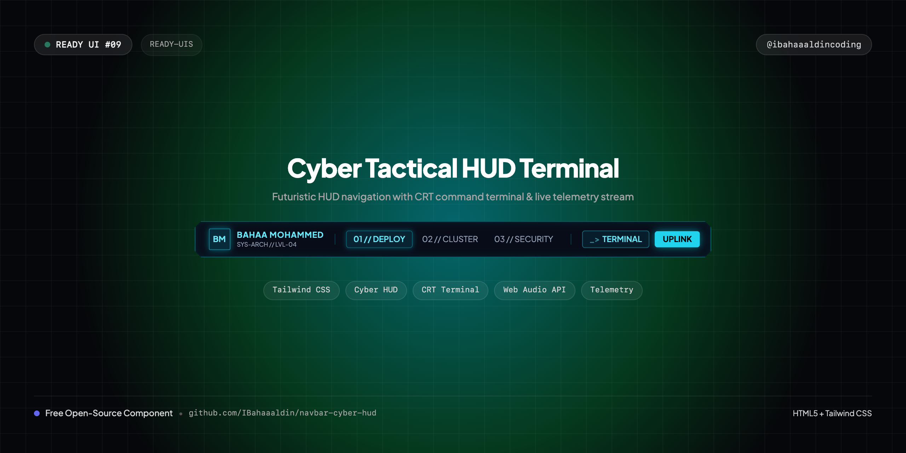
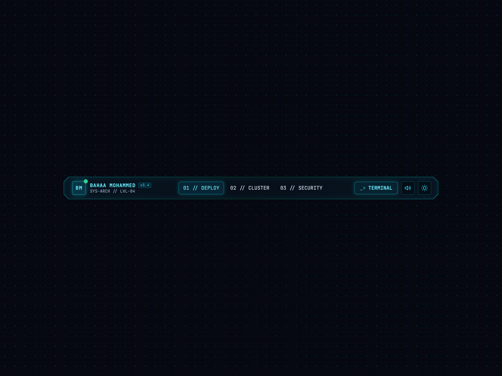
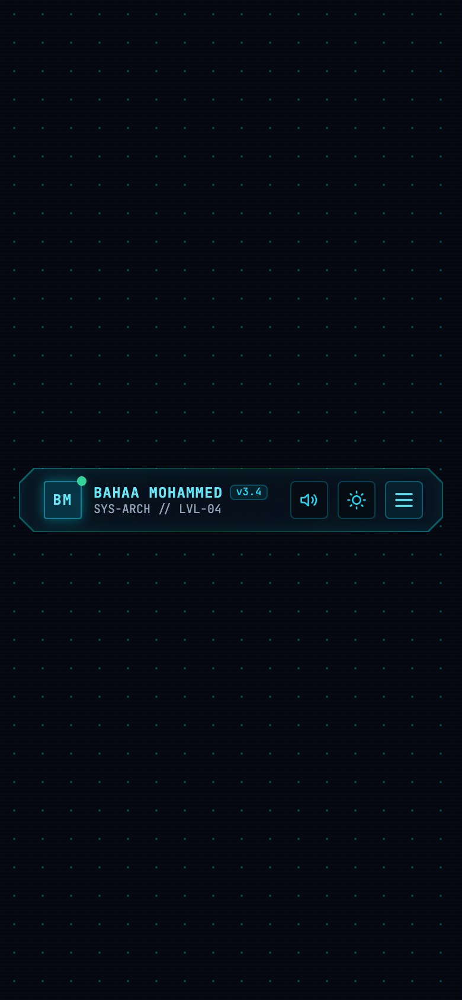
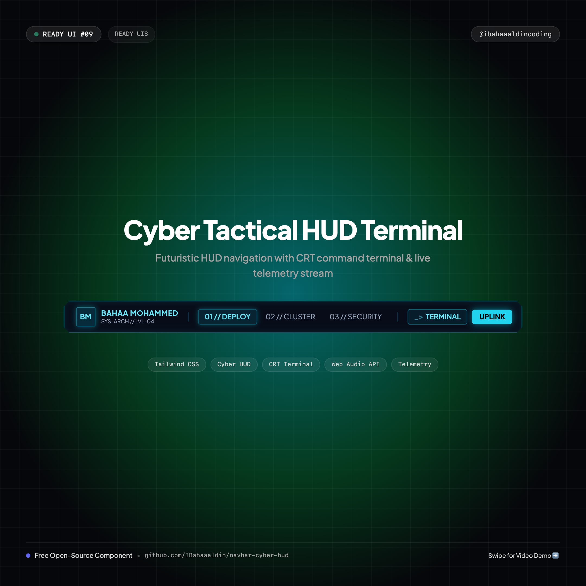
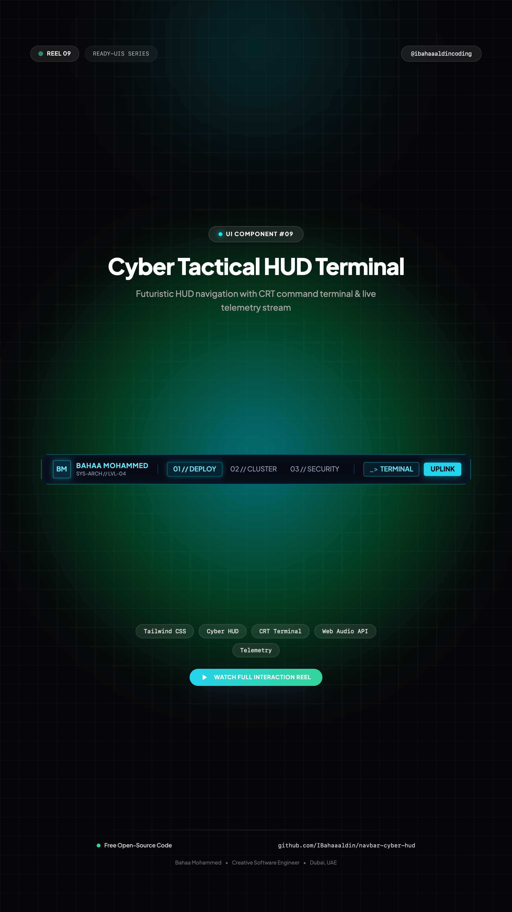

# ⚡ Cyber Tactical HUD Terminal Navbar

> An ultra-futuristic, high-tech tactical HUD navigation bar featuring chamfered cyber angles, real-time telemetry, a live CRT command terminal dropdown, audio synthesizer blips, and an authentic CRT scanline toggle.



[](https://IBahaaaldin.github.io/navbar-cyber-hud/)
[](https://IBahaaaldin.github.io/navbar-cyber-hud/)

---

## 🌐 Visual Previews

| Desktop Showcase (1200x900) | Mobile Showcase (390x844) | Post Cover (1080x1080) | Reel Cover (1080x1920) |
| :---: | :---: | :---: | :---: |
|  |  |  |  |

*(Includes full interaction videos: `video-desktop.mp4` and `video-mobile.mp4`)*

---

## ✨ Features & Micro-Interactions

- **Cyber Tactical Chamfered Geometry**: Angular clip-path cutouts with neon cyan (`#00f0ff`) and acid yellow-green (`#39ff14`) glowing borders.
- **Live HUD Telemetry**: Real-time interactive FPS counter, simulated network latency (ping ms), and system status diagnostics with active pulsing indicators.
- **Interactive CRT Command Terminal**: Dropdown HUD console with simulated cyber commands (`status`, `clear`, `scan`, `theme`, `help`) and typewriter response output.
- **Web Audio FX Synthesizer**: Native zero-asset Web Audio API bleeps, tactical clicks, and cyber hums on tab switching and mode toggles.
- **Authentic CRT Scanlines Toggle**: Switchable vintage scanlines overlay with phosphor glow simulation.
- **One-Click Tactical Uplink**: Fast "UPLINK" button that copies developer email (`bahaam.coding@gmail.com`) with animated matrix code confirmation.
- **Tactical Dark / Night Mode**: Seamless toggle between Deep Cyber Void (`#070a13`) and High-Contrast Tactical Gray.
- **Strict Single-Row Typography**: Creator name, roles, and telemetry readouts never wrap (`whitespace-nowrap`).
- **Responsive Slide-in Mobile Sheet**: Slides smoothly from the right edge with a dimmed backdrop and full HUD telemetry controls.
- **Zero Build Step**: Drop-in HTML5, Tailwind CSS CDN, and vanilla JS.

---

## 📁 Repository Structure

```text
├── index.html              # Standalone production navbar component
├── cover.png               # Widescreen cover banner (1280x640)
├── cover-instagram.png     # Square post cover for Instagram (@ibahaaaldincoding) (1080x1080)
├── cover-reel.png          # 9:16 vertical cover for Instagram Reels (1080x1920)
├── screenshot-desktop.png  # Desktop visual preview (1200x900)
├── video-desktop.mp4       # Desktop interaction recording (MP4)
├── screenshot-mobile.png   # Mobile visual preview (390x844)
├── video-mobile.mp4        # Mobile interaction recording (MP4)
├── record.js               # Playwright automation script used to record all 4 assets
├── README.md               # Documentation & setup notes
└── CAPTION.md              # Ready-to-copy Instagram caption for @ibahaaaldincoding
```

---

## 🚀 Quick Start

### 1. View Locally
Simply open `index.html` in your browser:
```bash
open index.html
```

### 2. Re-record Assets
To re-record desktop & mobile screenshots and videos:
```bash
node record.js
```

---

## 👤 Author & Connect

**Bahaa Mohammed**
Creative Developer & Software Engineer
- 📸 **Instagram**: [@ibahaaaldincoding](https://www.instagram.com/ibahaaaldincoding)
- 🐙 **GitHub**: [@IBahaaaldin](https://github.com/IBahaaaldin)
- 💼 **LinkedIn**: [Bahaa Mohammed](https://www.linkedin.com/in/bahaa-mohammed-371259369)
- 📧 **Email**: bahaam.coding@gmail.com

---

## 📄 License

MIT © [Bahaa Mohammed](https://github.com/IBahaaaldin)
