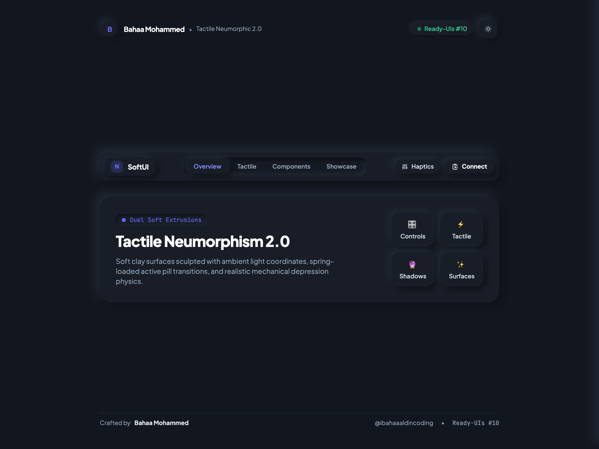
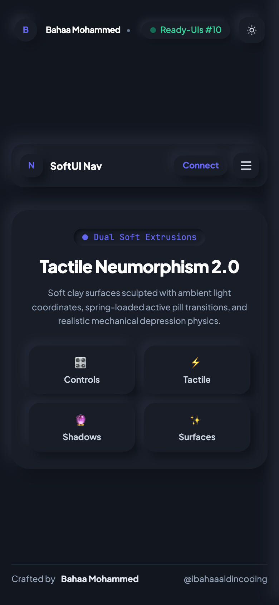

# 🎛️ Tactile Neumorphic Soft-UI Navbar

A tactile, modern Neumorphic Soft-UI 2.0 navigation bar featuring realistic dual-shadow light extrusions, physical inset depression physics, dynamic spring-loaded active pill indicators, interactive tactile haptic controls, and acoustic audio synthesis.

Crafted by **Bahaa Mohammed** ([@ibahaaaldincoding](https://www.instagram.com/ibahaaaldincoding)).

---

## ✨ Features & Motion Mechanics

- **Neumorphism 2.0 Sculpted Surfaces**: Ambient dual soft shadows mapped to directional light coordinates (`9px 9px 20px #... , -9px -9px 20px #...`).
- **Physical Inset Depression**: Interactive buttons and pills physically depress inwards with realistic inset shadows and scaling on mouse down.
- **Spring-Loaded Indicator Pill**: Smooth spring physics glide between tabs (*Overview*, *Tactile*, *Components*, *Showcase*) with dynamically calculated width and position.
- **Tactile Haptics Popover**: Interactive control panel with real-time shadow depth slider, acoustic feedback toggle, and tactile click tester.
- **Web Audio API Feedback**: Zero-asset audio synthesis generating crisp mechanical clicks, taps, and spring pops.
- **One-Click Quick Connect**: Tactile "Connect" button that copies developer email (`bahaam.coding@gmail.com`) with instant checkmark feedback and transition.
- **Instant Dark / Light Mode**: Seamless transition between Deep Obsidian Clay (`#12161f`) and Warm Sculptural Alabaster (`#edf2f7`).
- **Strict Single-Row Typography**: Creator name, roles, and status tags are locked into single lines (`whitespace-nowrap`).
- **Responsive Slide-in Mobile Sheet**: Slides smoothly from the right edge with a dimmed backdrop and tactile controls.
- **Zero Build Step**: Drop-in HTML5, Tailwind CSS CDN, and vanilla JS.

---

## 📸 Media Preview

| Desktop Preview | Mobile View |
| :---: | :---: |
|  |  |

---

## 🚀 Quick Start

```bash
git clone https://github.com/IBahaaaldin/navbar-neumorphic-soft.git
cd navbar-neumorphic-soft
open index.html
```

---

## 🛠 Tech Stack

- **HTML5 & Modern CSS3** (Neumorphic dual-shadow extrusions & spring cubic-beziers)
- **Tailwind CSS (v3 CDN)**
- **Vanilla JavaScript** (Spring pill physics, tactile slider & Web Audio synthesizer)
- **Playwright & FFmpeg** (Automated video and asset generation)

---

## 📄 License

MIT © [Bahaa Mohammed](https://github.com/IBahaaaldin)
