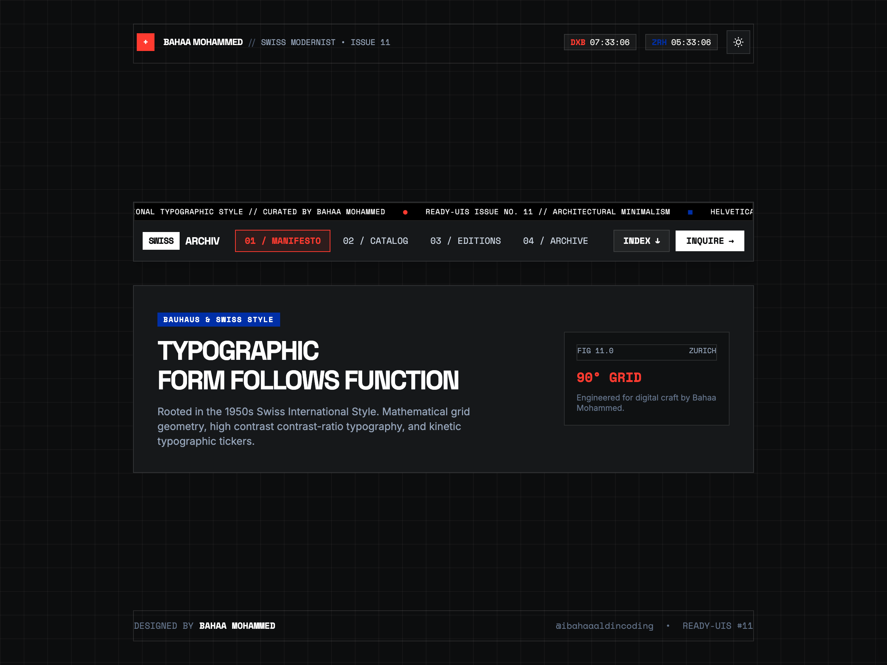
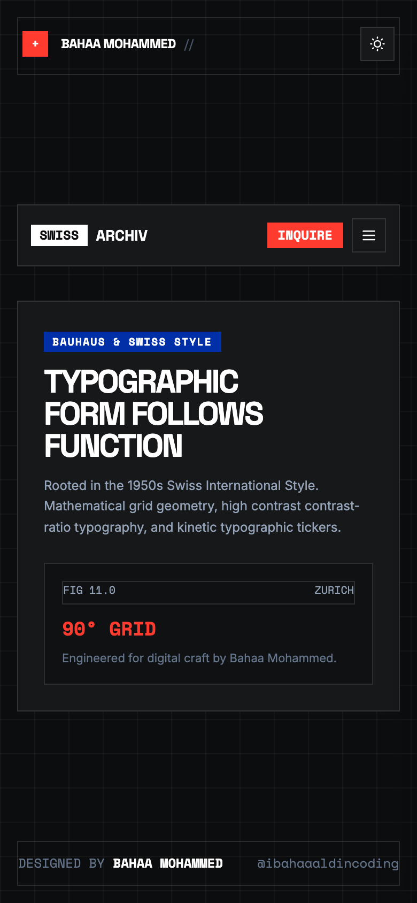

# 📐 Swiss International Editorial Navbar

A high-contrast modernist navigation bar inspired by Swiss Typographic Style, Bauhaus architectural grids, and editorial poster design. Featuring live real-time world clocks (Dubai & Zurich), a running kinetic typography marquee ribbon, an architectural index accordion drawer, and high-impact stark monochrome inversion.

Crafted by **Bahaa Mohammed** ([@ibahaaaldincoding](https://www.instagram.com/ibahaaaldincoding)).

---

## ✨ Features & Motion Mechanics

- **Swiss International Form Language**: Rooted in asymmetric grotesque typography, strict mathematical grid lines, and International Klein Blue (`#002FA7`) & Swiss Vermilion (`#FF3B30`) accents.
- **Live Synchronized World Clocks**: Real-time Greenwich/Dubai (`DXB`) and Zurich (`ZRH`) timekeepers dynamically ticking each second.
- **Kinetic Typographic Marquee**: Continuous smooth running ticker ribbon communicating issue metadata and typographic philosophy.
- **Architectural Index Drawer**: Collapsible 3-column editorial accordion detailing typography, spatial systems, and chromatic discipline.
- **One-Click Inquire Action**: Fast copy-to-clipboard button (`bahaam.coding@gmail.com`) with typewriter checkmark animation.
- **Stark Art Gallery Inversion**: Instant toggle between Deep Editorial Ink (`#0C0D0E`) and High-Contrast Architectural White Paper (`#F4F4F0`).
- **Strict Single-Row Typography**: Creator name, issues, and time zones never wrap (`whitespace-nowrap`).
- **Responsive Slide-in Mobile Sheet**: Architectural sidebar sheet sliding from the right with synced clocks and section links.
- **Zero Build Step**: Drop-in HTML5, Tailwind CSS CDN, and vanilla JS.

---

## 📸 Media Preview

| Desktop Preview | Mobile View |
| :---: | :---: |
|  |  |

---

## 🚀 Quick Start

```bash
git clone https://github.com/IBahaaaldin/navbar-swiss-editorial.git
cd navbar-swiss-editorial
open index.html
```

---

## 🛠 Tech Stack

- **HTML5 & Modern CSS3** (DIN 476 grid patterns & kinetic CSS marquee)
- **Tailwind CSS (v3 CDN)**
- **Vanilla JavaScript** (Intl DateTimeFormat live clocks & accordion physics)
- **Playwright & FFmpeg** (Automated video and asset generation)

---

## 📄 License

MIT © [Bahaa Mohammed](https://github.com/IBahaaaldin)
