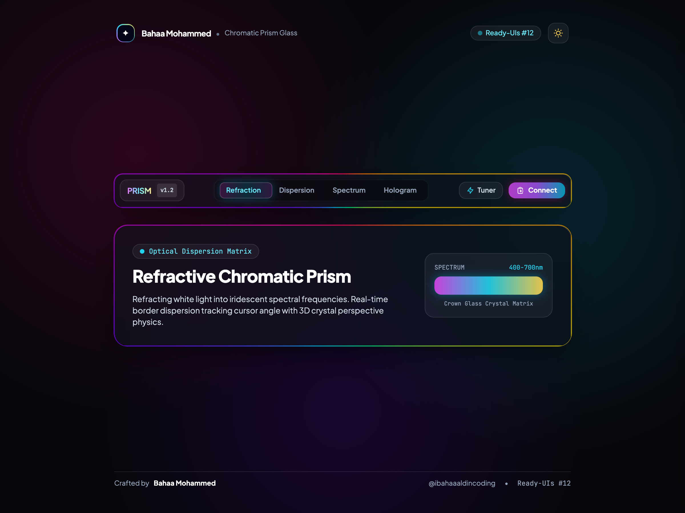
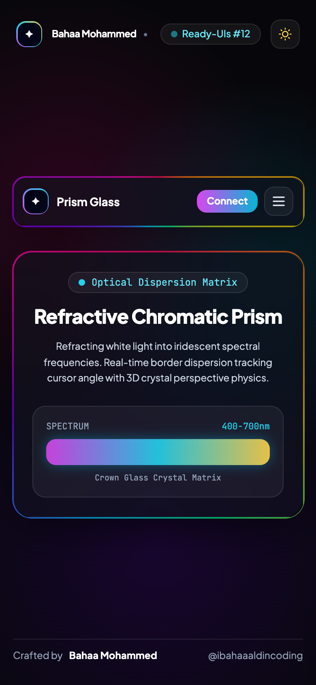

# 🔮 Refractive Chromatic Prism Glass Navbar

An ultra-modern, refractive glass navigation bar featuring real-time rainbow chromatic dispersion borders that track cursor coordinates, 3D prism perspective tilt physics, an interactive spectrum wavelength tuner, and pearlescent frosted glass transitions.

Crafted by **Bahaa Mohammed** ([@ibahaaaldincoding](https://www.instagram.com/ibahaaaldincoding)).

---

## ✨ Features & Motion Mechanics

- **Cursor-Tracking Chromatic Dispersion**: Dynamic conic-gradient rainbow border simulating optical light refraction through a triangular prism based on cursor angle `Math.atan2(deltaY, deltaX)`.
- **3D Perspective Crystal Tilt**: Smooth perspective rotation (`rotateX`, `rotateY`, `translateZ`) in 3D coordinate space.
- **Magnetic Iridescent Sliding Pill**: Smooth spring active capsule with subtle rainbow reflection underneath selected tabs.
- **Interactive Spectrum Tuner Popover**: Popover control to adjust wavelength dispersion (`380nm - 750nm`) with simulated Crown Glass refraction index (`n = 1.520`).
- **One-Click Connect Action**: Holographic gradient button that copies email (`bahaam.coding@gmail.com`) with instant checkmark feedback and transition.
- **Instant Dark / Light Quartz Mode**: Seamless toggle between Deep Obsidian Crystal Void (`#07070b`) and Pearlescent Frosted Quartz (`#f8f9fc`).
- **Strict Single-Row Typography**: Creator name, roles, and status tags are locked into single lines (`whitespace-nowrap`).
- **Responsive Slide-in Mobile Sheet**: Slides smoothly from the right edge with a dimmed backdrop and full prism spectrum controls.
- **Zero Build Step**: Drop-in HTML5, Tailwind CSS CDN, and vanilla JS.

---

## 📸 Media Preview

| Desktop Preview | Mobile View |
| :---: | :---: |
|  |  |

---

## 🚀 Quick Start

```bash
git clone https://github.com/IBahaaaldin/navbar-chromatic-prism.git
cd navbar-chromatic-prism
open index.html
```

---

## 🛠 Tech Stack

- **HTML5 & Modern CSS3** (Conic-gradients, mask composites & 3D CSS perspective)
- **Tailwind CSS (v3 CDN)**
- **Vanilla JavaScript** (Real-time optical angle calculation & perspective physics)
- **Playwright & FFmpeg** (Automated video and asset generation)

---

## 📄 License

MIT © [Bahaa Mohammed](https://github.com/IBahaaaldin)
